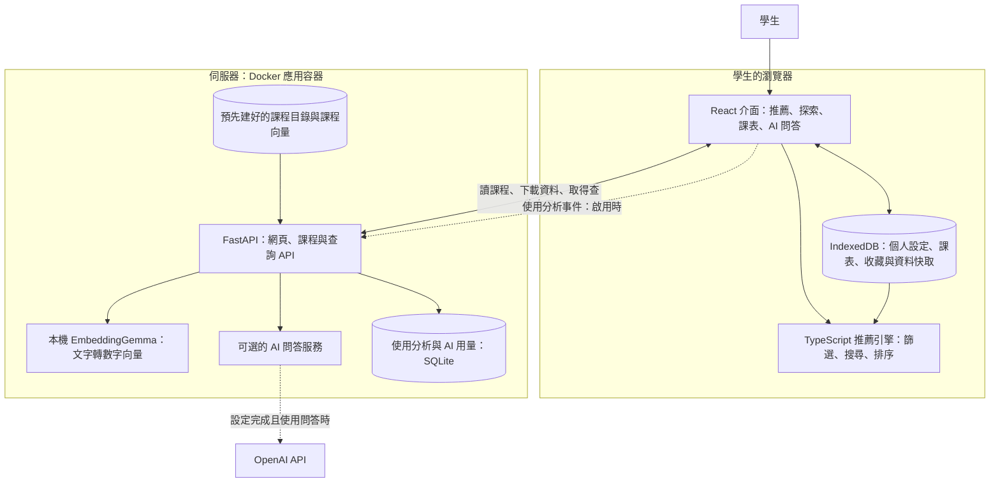
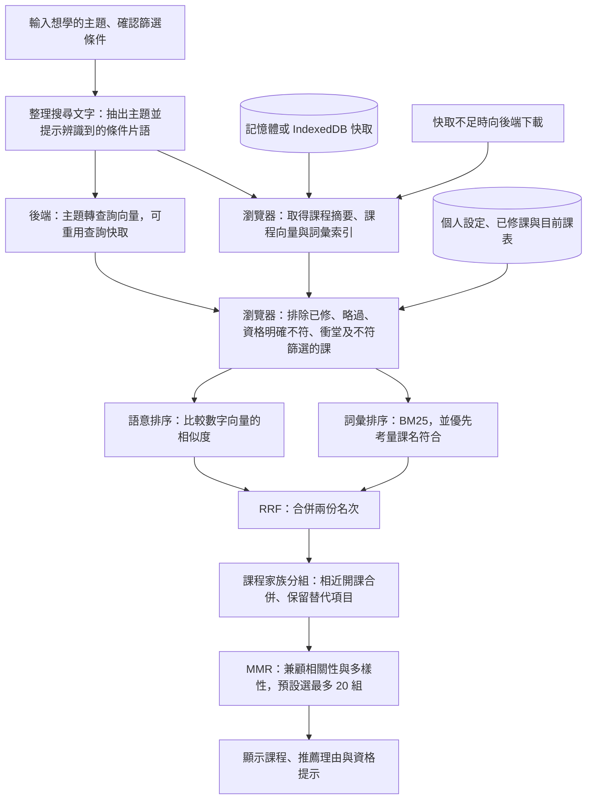
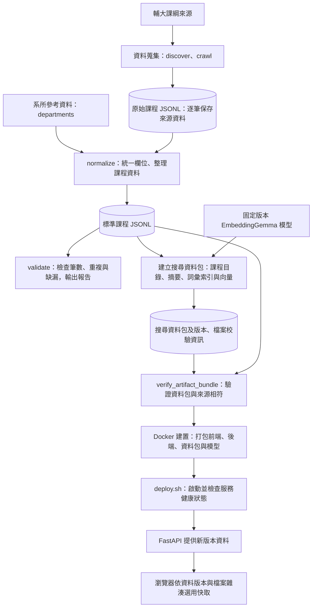

# 系統架構導覽

核對日期：2026-11-24。依目前工作目錄原始碼整理，包含尚未提交的變更；不代表線上正在執行的版本。這是靜態程式閱讀結果，沒有連線驗證正式環境或執行完整資料更新。

## 1. 系統全貌：誰負責什麼

瀏覽器不只顯示畫面，也執行主要推薦排序。伺服器提供網頁、課程資料，並把搜尋文字轉成可以比較相似度的數字向量。IndexedDB 是瀏覽器內的資料庫；SQLite 是伺服器上的檔案型資料庫，兩者用途不同。個人資料主要保存在瀏覽器，不代表所有操作資料都留在本機：搜尋主題會傳給後端，問答有獨立的外部服務路徑，使用分析也有後端接收端。

實線表示主要關係，虛線表示條件式功能。AI 問答是否可用取決於設定與服務初始化；此圖沒有確認實際啟用狀態。一般推薦使用本機向量模型，不經過圖中的 OpenAI 問答路徑。

對照：`frontend/src/data/api.ts`、`frontend/src/data/db.ts`、`frontend/src/domain/recommendation.ts`、`src/fju_outline/web.py`、`src/fju_outline/rag.py`、`src/fju_outline/analytics.py`、`Dockerfile`、`compose.yaml`。

## 2. 一次推薦搜尋：怎麼變成課程清單

語意搜尋找「意思接近」的課；詞彙搜尋找「文字對得上」的課。RRF（倒數排名融合）把兩邊的名次合併；MMR（最大邊際相關性）避免推薦結果過度雷同。這些是計算規則，推薦理由也有程式組裝路徑，不需要生成式 AI 現場撰寫。

重要差異：目前一般推薦實作先篩選候選課程，再合併排序；舊 README 的概念圖畫成先合併再篩選。資格不確定不一定排除，先修課程也有特別保留的邏輯，不可把推薦視為校方的選課資格保證。

這張圖對應目前 `RecommendPage` 的一般推薦入口。程式另有複合查詢解析與排序能力，後端開關預設關閉；不能只因為存在解析器，就認定一般推薦頁會自動完整套用自然語言中的所有限制。圖中的文字整理也不等於完整理解句意，篩選應以介面實際套用的條件為準。

對照：`frontend/src/pages/recommend/RecommendPage.tsx`、`frontend/src/domain/subjectQuery.ts`、`frontend/src/data/queries.ts` 的 `useRecommendationSources`、`frontend/src/domain/recommendation.ts` 的 `rankSingleCourses`、`frontend/src/domain/search.ts`、`src/fju_outline/web.py` 的 `/api/v1/query-embedding`。

## 3. 資料更新：網站的課程從哪裡來

這是更新資料時才進行的準備工作，不是學生每搜尋一次就重新爬資料。JSONL 是每行存一筆資料的文字格式；搜尋資料包是預先算好的課程目錄、索引和向量；雜湊是用來辨識檔案內容是否改變的指紋。課程向量與查詢向量必須使用相容模型，否則相似度比較沒有可靠意義。

圖呈現程式支援的資料路徑，不表示有一條已確認的自動排程會一路執行到底。`validate` 是獨立命令，產生報告，不是圖中建置步驟的強制自動關卡。正式資料包有較嚴格的 `scripts/build_embedding_bundle.py` 建置與鎖定資訊；一般 CLI `artifacts` 入口也存在。額外的開課人數資料可經選用的 sidecar（附加資料檔）併入，此圖省略該支線。

對照：`src/fju_outline/cli.py`、`src/fju_outline/crawler.py`、`src/fju_outline/normalize.py`、`src/fju_outline/config.py`、`src/fju_outline/artifacts.py`、`scripts/build_embedding_bundle.py`、`scripts/verify_artifact_bundle.py`、`Dockerfile`、`deploy.sh`、`frontend/src/data/api.ts` 的 `artifactCacheKey`。

## 維護上的取捨

- 學生端：本機保存設定、重用課程資料，可減少重複下載；換裝置時資料是否搬移要另外處理，瀏覽器清除資料也會影響保存內容。
- 維護端：瀏覽器排序減少伺服器逐次排序工作，但較多課程資料需要送到使用者裝置，裝置效能也會影響體驗。
- 資料端：固定版本與校驗讓結果較容易重現；代價是新學期資料要重新整理、建置與部署，不會只因來源網站更新就自動出現在服務中。
